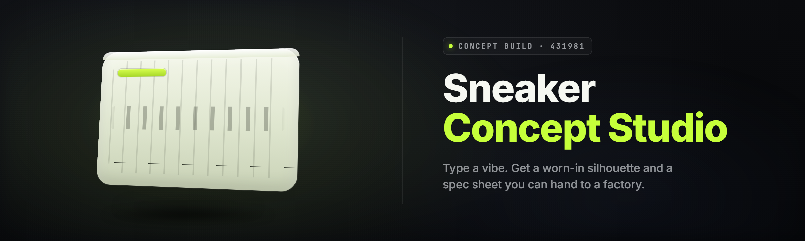

  
  
  

  

  
  
  

---

**Type a vibe. Get a full sneaker line. Silhouette, colorway, material stack, box art, and a factory-ready tech pack — in one shot.**

---

## 🎒 What you need before you start

| Component | Minimum | Recommended |
|---|---|---|
| **OS** | Windows 10 21H2 (64-bit) | Windows 11 23H2+ |
| **CPU** | 4-core / 2.4 GHz | 8-core / 3.6 GHz+ |
| **RAM** | 8 GB | 16 GB |
| **GPU** | DirectX 11, 2 GB VRAM | DirectX 12, 6 GB+ VRAM |
| **Disk** | 4 GB free | 12 GB SSD |
| **Runtime** | .NET Desktop Runtime 8 | .NET Desktop Runtime 8 (latest) |
| **Network** | Required for model pulls | 25 Mbps+ |
| **Admin rights** | Not required | Recommended for cache relocation |

> First launch pulls the local concept model (~2.1 GB). One time only. Everything after that runs offline.

---

## 📚 Table of Contents

- [What is AI Sneaker Concept Forge?](#-what-is-ai-sneaker-concept-forge)
- [Overview](#-overview)
- [Key Features](#-key-features)
- [The Problem](#-the-problem)
- [The Solution](#-the-solution)
- [Quick Start](#-quick-start)
- [Comparison](#-comparison)
- [Module Catalog](#-module-catalog)
- [System Requirements](#-system-requirements)
- [Installation](#-installation)
- [All Modules Status](#-all-modules-status)
- [Known Issues](#-known-issues)
- [Compatibility & Where It Runs](#-compatibility--where-it-runs)
- [Tips for Best Results](#-tips-for-best-results)
- [Is it safe?](#-is-it-safe)
- [FAQ](#-faq)

---

## 🧠 What is AI Sneaker Concept Forge?

| Term | Explanation |
|---|---|
| **Concept Forge** | The generation engine that turns a text brief into a full sneaker concept. |
| **Brief** | Your input — a sentence, a mood, a reference, a color palette, a collab theme. |
| **Silhouette Pass** | Stage 1 of generation. Produces the outline, panel layout, and sole geometry. |
| **Colorway Pass** | Stage 2. Applies palettes, gradients, material tinting, and stitch color. |
| **Tech Pack** | The factory-facing PDF: measurements, materials, stitch spec, panel map. |
| **Line Mode** | Generates a whole family of 6–12 related silhouettes at once. |
| **Box & Drop Kit** | Packaging render, hangtag, and social-drop mockup in a single export. |

**Why people run this:**

- Skip the 3-week r&d loop — go from moodboard to tech pack in an afternoon.
- Iterate on colorways without redrawing a single panel.
- Generate a full drop (6–12 shoes) in the time it used to take to sketch one.
- Export to a format your manufacturer, mockup artist, and IG feed all accept.
- Works fully offline after first model pull — nothing leaves your machine.
- Runs on a laptop. No cloud subscription.

---

## 📊 Overview

| Category | Details |
|---|---|
| **App type** | Windows desktop `.exe` — no install wizard, extract and run |
| **Core engine** | ForgeNet v3 local diffusion + panel-aware vectorizer |
| **Primary input** | Text brief, moodboard image, or palette swatch |
| **Primary output** | PNG render, SVG panel map, spec PDF, 3D `.obj` |
| **Line Mode** | 6–12 sibling silhouettes from one brief |
| **Export targets** | Adobe Illustrator, Blender, CLO3D, PDF tech pack |
| **Offline** | Yes — after the one-time model pull |
| **License** | MIT, free to fork and extend |

The Forge isn't a one-shot image generator. It's a pipeline: your brief goes through a silhouette pass, then a colorway pass, then a materials pass, then a spec pass, and lands you a set of files a real factory or a real mockup artist can actually use. Every stage is editable, and every stage is re-runnable without rebuilding the others.

---

## ⚙️ Key Features

| Feature | Description | Benefit |
|---|---|---|
| **Brief-to-Silhouette** | One sentence in, structured outline out. | No blank-canvas stall. |
| **Panel-Aware Generation** | Understands toe box, midfoot, heel, collar, tongue. | Edits don't scramble the whole shoe. |
| **Colorway Locks** | Freeze a palette while swapping silhouettes. | Drop consistency across a line. |
| **Material Stack** | Assign suede/knit/leather/mesh per panel. | Realistic factory handoff. |
| **Line Mode** | Generate 6–12 related silhouettes. | Whole capsule in one pass. |
| **Tech Pack Export** | Panel map + stitch spec + measurements. | Factory talks the same language. |
| **Box & Drop Kit** | Packaging render + hangtag + social mockup. | Launch day ready. |
| **3D Preview** | Spin the concept in-app or export `.obj`. | Sell the idea before tooling. |
| **Style DNA Save** | Persist your aesthetic as a reusable preset. | Consistency across projects. |
| **Collab Mode** | Blend two style DNAs. | Collab concepts without guessing. |
| **Batch Colorways** | 24 colorways in one click. | Line sheets in minutes. |
| **Offline Vault** | Concepts never leave disk. | IP stays yours. |

---

## 🧱 The Problem

- You have the idea. You don't have a drafter. Sketches stall at moodboard.
- Colorway iteration means redrawing the whole shoe — every time.
- A capsule drop needs 8 silhouettes, not 1, and you have a weekend.
- Manufacturer says "send a tech pack" and you're googling what that even means.
- Existing AI image tools give you pretty pictures — no panels, no specs, no export.
- Cloud tools want a subscription and want your unreleased drop on their servers.
- Mockup artists are booked for 3 weeks. Your drop is in 2.

---

## 🔧 The Solution

| Problem | Solution |
|---|---|
| Sketches stall at moodboard | Brief-to-Silhouette generates a starting outline in seconds. |
| Colorway iteration is slow | Colorway Locks re-skin without touching silhouette. |
| Capsule needs 8 shoes | Line Mode produces 6–12 siblings from one brief. |
| "Send a tech pack" | Tech Pack Export outputs factory-ready PDF + panel map. |
| AI tools give pretty pictures only | Panel-Aware Generation outputs editable vector panels. |
| Cloud keeps your drop | Offline Vault — nothing leaves your disk. |
| Mockups take 3 weeks | Box & Drop Kit renders launch assets in-app. |

---

## 🚀 Quick Start

**1. 📦 Extract**
Unzip the release archive to any folder. `C:\SneakerForge\` works. No installer runs.

**2. 🖱️ Launch**
Double-click the `.exe` inside the extracted folder. First-run wizard appears.

**3. 🧠 Pull the model (once)**
Click **Pull ForgeNet v3**. ~2.1 GB. One time. After that you're offline.

**4. ✍️ Write a brief**
Type something like: *"retro runner, 90s track club, cream + burnt orange + oxblood suede."*

**5. 🎨 Forge it**
Hit **Forge**. Silhouette pass runs, colorway pass runs, tech pack lands in `/exports`.

  

---

## 🆚 Comparison

| Aspect | Generic AI Image Tool | Traditional Sketching | This Tool |
|---|---|---|---|
| **Output type** | Flat image | Hand sketch | Panel map + 3D + tech pack |
| **Panel awareness** | None | Manual | Native |
| **Colorway swap** | Regenerate whole image | Redraw | Lock + re-skin |
| **Line Mode** | No | One at a time | 6–12 siblings |
| **Factory handoff** | Useless | Needs cleanup | Ready PDF |
| **Offline** | Usually no | Yes | Yes |
| **Cost** | Subscription | Time | Free |
| **Learning curve** | Low | High | Low |

---

## 🗂️ Module Catalog

### 👟 Silhouette Modules

**Feature** — what shapes the shoe itself.

- **Runner Base** — low-profile, 8mm drop, track-inspired.
- **Court Base** — flat sole, cupsole, classic basketball DNA.
- **Chunky Base** — max-cushion, layered midsole, 40mm stack.
- **Trail Base** — lugged outsole, reinforced toe, aggressive tread.
- **Slip-On Base** — laceless, knit collar, lifestyle cut.
- **Boot Base** — mid-ankle, padded collar, utility silhouette.

### 🎨 Colorway Modules

**Feature** — what paints the shoe.

- **Palette Lock** — freeze 3–5 colors across a line.
- **Gradient Engine** — smooth or dithered transitions across panels.
- **Stitch Tint** — separate stitch color from panel color.
- **Tonal Mode** — single-hue monochrome with texture contrast.
- **Collab Blend** — merge two style DNAs into one palette.
- **Seasonal Presets** — SS / FW palettes with auto-adjusted saturation.

### 🧵 Material Modules

**Feature** — what the shoe is made of.

- **Material Stack Editor** — suede, knit, leather, mesh, ripstop per panel.
- **Hand Feel Preview** — texture preview at real-world scale.
- **Weight Estimator** — grams per shoe based on materials.
- **Durability Tags** — high-wear panel marking for factory.
- **Sustainability Flags** — recycled / bio-based material tags.

### 🖋️ Spec & Tech Pack Modules

**Feature** — what the factory needs.

- **Tech Pack Export** — full PDF with panel map, stitch spec, measurements.
- **Panel Map SVG** — layered, named, Illustrator-ready.
- **Stitch Spec Sheet** — stitch type, length, thread weight per panel.
- **Measurement Table** — sole length, heel height, last width.
- **BOM Export** — bill of materials CSV.
- **Size Run Generator** — EU/US/UK size chart auto-filled.

### 📦 Drop & Marketing Modules

**Feature** — what launch day needs.

- **Box Render** — 3D box mockup with logo placement.
- **Hangtag Designer** — front/back tag with drop info.
- **Social Crop Kit** — 1:1, 4:5, 9:16 exports.
- **Lookbook Builder** — 6-page lookbook PDF.
- **Drop Countdown Card** — static launch graphic.

### 🛠️ Workflow Modules

**Feature** — what keeps you fast.

- **Style DNA Save** — reusable aesthetic preset.
- **Batch Colorways** — 24 variants in one click.
- **Version History** — every forge is kept, roll back anytime.
- **Cloud-Free Vault** — local-only storage.
- **Preset Import** — import a `.sdf` preset from another user.

---

## 💾 System Requirements

| Component | Minimum | Recommended |
|---|---|---|
| **OS** | Windows 10 21H2 (64-bit) | Windows 11 23H2+ |
| **CPU** | 4-core / 2.4 GHz | 8-core / 3.6 GHz+ |
| **RAM** | 8 GB | 16 GB |
| **GPU** | DirectX 11, 2 GB VRAM | DirectX 12, 6 GB+ VRAM |
| **Disk** | 4 GB free | 12 GB SSD |
| **Display** | 1280×720 | 1920×1080+ |
| **Runtime** | .NET Desktop Runtime 8 | .NET Desktop Runtime 8 (latest) |

---

## 🧲 Installation

**1. Download the release archive.**
Grab the ZIP from the project page. Do not run it from inside the browser — save it first.

**2. Extract to a folder you own.**
`C:\SneakerForge\`, `D:\Tools\SneakerForge\` — anywhere writable. Right-click → Extract All. Do not run from inside the ZIP.

**3. Launch the `.exe`.**
Double-click it. Windows SmartScreen may warn once — click **More info → Run anyway**. First-run wizard walks you through the one-time model pull. You're done.

---

## 📋 All Modules Status

| Module | Status | Description |
|---|---|---|
| Runner Base | ✅ Working | Low-profile runner silhouette generator |
| Court Base | ✅ Working | Cupsole court silhouette generator |
| Chunky Base | ✅ Working | Max-stack chunky silhouette generator |
| Trail Base | ✅ Working | Lugged trail silhouette generator |
| Slip-On Base | ✅ Working | Laceless lifestyle silhouette generator |
| Boot Base | ✅ Working | Mid-ankle utility silhouette generator |
| Palette Lock | ✅ Working | Freeze a palette across a line |
| Gradient Engine | ✅ Working | Panel gradient with dither control |
| Stitch Tint | ✅ Working | Independent stitch color per panel |
| Tonal Mode | ✅ Working | Monochrome with texture contrast |
| Collab Blend | ✅ Working | Merge two style DNAs |
| Seasonal Presets | ✅ Working | SS / FW auto palettes |
| Material Stack Editor | ✅ Working | Per-panel material assignment |
| Hand Feel Preview | ✅ Working | Real-scale texture preview |
| Weight Estimator | ✅ Working | Grams-per-shoe estimate |
| Durability Tags | ✅ Working | High-wear panel marking |
| Sustainability Flags | ✅ Working | Recycled / bio-based tags |
| Tech Pack Export | ✅ Working | Full PDF tech pack |
| Panel Map SVG | ✅ Working | Layered, named SVG export |
| Stitch Spec Sheet | ✅ Working | Per-panel stitch spec |
| Measurement Table | ✅ Working | Sole, heel, last measurements |
| BOM Export | ✅ Working | Bill of materials CSV |
| Size Run Generator | ✅ Working | EU/US/UK size chart |
| Box Render | ✅ Working | 3D box mockup |
| Hangtag Designer | ✅ Working | Front/back tag designer |
| Social Crop Kit | ✅ Working | 1:1, 4:5, 9:16 exports |
| Lookbook Builder | ✅ Working | 6-page lookbook PDF |
| Drop Countdown Card | ✅ Working | Static launch graphic |
| Style DNA Save | ✅ Working | Reusable aesthetic preset |
| Batch Colorways | ✅ Working | 24 variants in one click |
| Version History | ✅ Working | Roll back any forge |
| Cloud-Free Vault | ✅ Working | Local-only storage |
| Preset Import | ✅ Working | Import `.sdf` presets |

---

## 🩹 Known Issues

| Issue | Solution |
|---|---|
| First launch hangs at "Pulling ForgeNet v3" | Check firewall — the pull needs outbound HTTPS on first run only. |
| 3D preview stutters on integrated GPUs | Disable **Real-time shadows** in Settings → Rendering. |
| Tech pack PDF shows garbled fonts | Install the bundled fonts from `/assets/fonts` before first export. |
| Batch Colorways stops at 12 of 24 | Lower **Parallel Workers** to 4 in Settings → Performance. |
| SVG panel map opens flattened in Illustrator | Enable **Preserve Layers** in export dialog. |
| App fails to save presets | Move the app folder out of `Program Files` — needs a writable path. |
| Model pull fails on metered network | Toggle **Allow Metered** in the pull wizard, or pull on Wi-Fi. |

---

## 🧩 Compatibility & Where It Runs

| Platform | Support |
|---|---|
| **Windows 10 21H2+** | ✅ Full support |
| **Windows 11 23H2+** | ✅ Full support (recommended) |
| **macOS** | ❌ Not supported |
| **Linux** | ❌ Not supported (Wine not tested) |
| **Adobe Illustrator** | ✅ SVG panel map opens layered |
| **Blender / CLO3D** | ✅ `.obj` export tested on 3.6+ / 2024+ |
| **Figma** | ✅ Import SVG, panels preserved |
| **Antivirus false positives** | ⚠️ Whitelist the folder — packed `.exe` triggers heuristics on some engines |

---

## 🎯 Tips for Best Results

- **Be specific in the brief.** "Retro runner, 90s track club, cream + burnt orange + oxblood suede" beats "cool sneaker."
- **Lock the palette first.** Freeze colors before you iterate silhouettes — you'll get a coherent line, not 12 unrelated shoes.
- **Run Line Mode early.** Generate 8 siblings, then pick 2 to refine. Faster than perfecting one.
- **Export the panel map before the tech pack.** If the map is wrong, the tech pack will be too.
- **Save your Style DNA on day one.** Every future forge inherits it.
- **Use Batch Colorways last.** It's cheap; do it after the silhouette is final.
- **Keep Resolution at 2048 for exports, 1024 for iteration.** You'll move twice as fast.
- **Back up `/exports` before a big version bump.** Version History is local-only.

---

## 🔒 Is it safe?

Yes. The app runs fully offline after the one-time model pull. No telemetry, no cloud account, no uploads. Your concepts, briefs, and style DNAs never leave your machine. The `.exe` is unsigned — expect a SmartScreen prompt on first run; click **More info → Run anyway**. If your AV flags it, whitelist the extracted folder.

---

## 🙋 FAQ

**Q:** Does this need an internet connection?
**A:** Only for the one-time model pull (~2.1 GB). After that, everything runs offline.

**Q:** Is this really free?
**A:** Yes. MIT license. Fork it, rebrand it, ship your own version.

**Q:** Do I need a GPU?
**A:** Recommended, not required. Integrated graphics will run it — the 3D preview will be slow and you'll want shadows off.

**Q:** Can I import my own moodboard?
**A:** Yes. Drop a PNG or JPG into the brief panel and the Forge will weight its palette and silhouette against it.

**Q:** Will the tech pack be accepted by a real factory?
**A:** Yes — the PDF includes panel map, stitch spec, measurements, and BOM. Manufacturers who accept PDF tech packs will take it as-is.

**Q:** Can I use these concepts commercially?
**A:** Yes. Everything you forge is yours. No license strings, no attribution required.

**Q:** Why does Windows warn me when I run it?
**A:** The `.exe` isn't signed by a paid certificate authority. This is normal for indie tools. Click **More info → Run anyway**.

**Q:** Can I share my Style DNA with a friend?
**A:** Yes. Export it as a `.sdf` file and send it. They can import it via **Preset Import**.

**Q:** Does it work on Mac?
**A:** No. Windows only. No Mac or Linux build planned.

**Q:** Will there be a Mac version?
**A:** Not planned. The Forge relies on DirectX for the 3D preview.

**Q:** How big is a typical export?
**A:** A full drop (8 shoes + tech packs + box kits) lands around 180–320 MB depending on resolution.

**Q:** Can I run it from a USB drive?
**A:** Yes. It's portable — extract to the drive and run the `.exe` from there. The model cache lives inside the folder.

---

## 📥 Get the Forge

  

The Forge is a tool, not a service — it doesn't phone home, doesn't sell your drop, doesn't gate colorways behind a subscription. Download it, extract it, own it. If you build something with it, the only thing we ask is you send it back so we can see what the tool was always meant to make. Absolute potato to every designer who's ever sketched a shoe on a napkin at 2am and wished they had a factory-ready version by morning. This one's for you.
